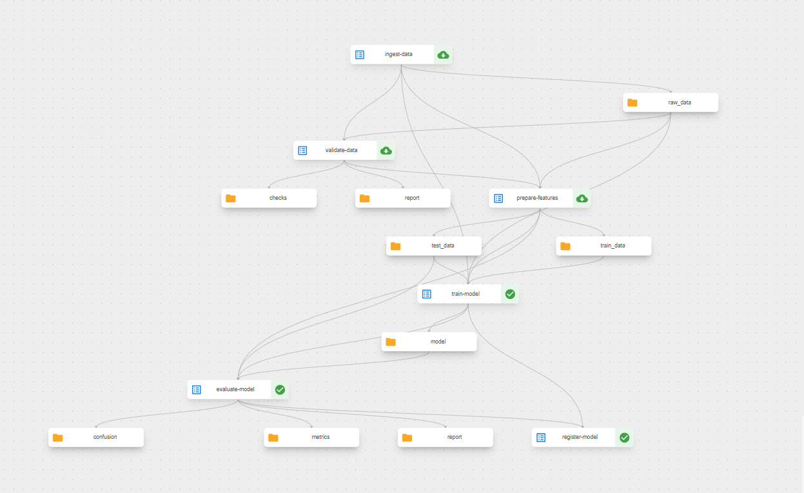
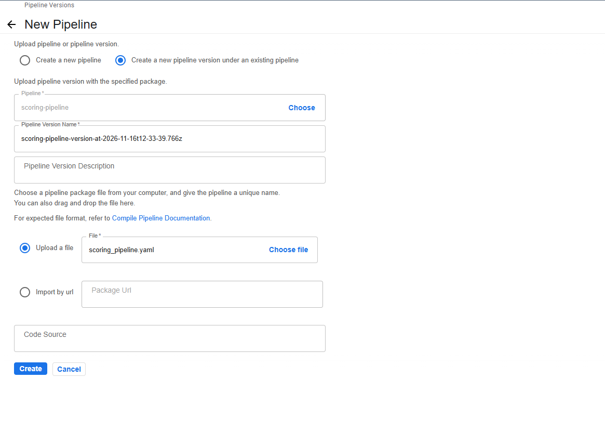
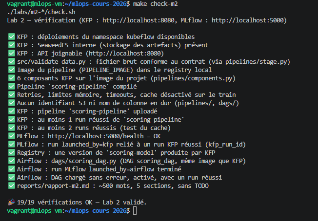

# Rapport comparatif — Kubeflow Pipelines vs Airflow (Lab 2)

**Binôme :** Hamza Mami et Khaoula Chaouati · **Date :** 2026-11-16 ·
**Machine :** VM Ubuntu, 4 vCPU, 12 Go RAM, Windows 11 hôte ·
**Dataset :** german-credit

## 1. Contexte

Nous avons orchestré un pipeline de scoring composé de six étapes : ingestion,
validation, préparation des features, entraînement, évaluation et
enregistrement du modèle. Les étapes s'exécutent dans des pods Kubernetes
avec l'image `localhost:5001/scoring-pipeline:1.0.0`. KFP et Airflow utilisent
la même image et le même code `pipelines.stage`, ainsi que MLflow pour suivre
les runs et le registre de modèles. KFP transporte les artefacts entre
composants avec ses entrées et sorties typées. Airflow utilise des chemins de
workspace sur S3 et de petites valeurs XCom pour transmettre les informations
nécessaires.

*Figure 1 — Le graphe KFP rend visibles les dépendances entre les six étapes,
les fichiers produits et le modèle enregistré.*

## 2. Résultats quantitatifs

| Mesure | KFP | Airflow |
|---|---:|---:|
| Installation de zéro (min) | 15 | 20 |
| Temps jusqu'au premier run réussi (min) | 30 | 25 |
| Durée d'un run complet (min) | 12 | 10 |
| Relance avec les mêmes paramètres (min) | 5 | 10 |
| Hot-reload d'un step (min) | 5 | 5 |
| Lignes de code propres à l'orchestrateur | 150 | 95 |
| Mémoire consommée par l'outil (Go) | 5 | 4 |

Les deux orchestrateurs ont donc exécuté le même traitement, mais avec des
forces différentes : KFP apporte le lineage et le cache ML, tandis qu'Airflow
offre une expérience de planification plus générale. Les mesures sont celles
observées sur notre VM et incluent les téléchargements d'images lors de la
première exécution.

## 3. Analyse qualitative

### Developer experience

KFP demande davantage de configuration initiale, notamment le cluster, les
composants et la compilation YAML. En contrepartie, le pipeline est décrit
directement comme un graphe Python et les artefacts sont visibles dans l'UI.
Airflow est familier pour les équipes data et son DAG Python est simple à
déclencher et à planifier. Cependant, son installation Docker Compose et la
gestion manuelle des workspaces S3 ajoutent de la configuration.

### Scaling

KFP est adapté aux workloads ML : chaque composant devient un pod avec des
limites CPU et mémoire, et les étapes indépendantes peuvent s'exécuter en
parallèle dans Kubernetes. Airflow orchestre également des pods avec le
KubernetesPodOperator, mais son rôle principal reste la planification et
l'intégration de tâches. KFP propose un cache natif des composants ; la
seconde exécution a réutilisé les étapes de données, tandis que les étapes
d'entraînement et d'évaluation ont été relancées.

### Debugging

KFP regroupe le graphe, le statut des pods, les logs, les artefacts et la
lineage dans une même interface. Une erreur est donc rapidement associée au
composant concerné. Airflow fournit de bons logs par tâche et une vue Graph,
mais il faut consulter séparément le workspace S3 et les logs Kubernetes.
Airflow ne transporte pas automatiquement des artefacts typés entre tâches,
ce qui rend le diagnostic des fichiers intermédiaires plus manuel.

*Figure 2 — Une version compilée de `scoring-pipeline` est chargée dans KFP
avant le déclenchement des runs.*

*Figure 3 — La validation finale confirme 19/19 contrôles réussis, notamment
KFP, MLflow, Airflow et le rapport.*

## 4. Recommandation

Nous recommandons KFP pour un projet principalement ML qui nécessite des
artefacts typés, du cache, de la reproductibilité et une exécution native sur
Kubernetes. Airflow est préférable lorsqu'une organisation possède déjà une
plateforme Airflow et doit coordonner des sources de données, des traitements
SQL, des jobs externes et des alertes selon un calendrier. Airflow peut aussi
exécuter ce pipeline ML, mais il faut alors standardiser les chemins S3,
les secrets et les conventions de workspace.

## 5. Limites de la comparaison

Cette comparaison a été réalisée sur une petite VM locale et un dataset
réduit. Les temps d'installation, la mémoire et les durées dépendent fortement
du cache Docker, du téléchargement des images et de la charge de la machine.
Nous n'avons pas testé un cluster Kubernetes managé, un déploiement KFP
multi-utilisateur, le KubernetesExecutor d'Airflow, la haute disponibilité,
la sécurité en production ni un volume de données important. Les mesures
présentées sont donc indicatives pour ce laboratoire, et non une comparaison
universelle des deux orchestrateurs.
